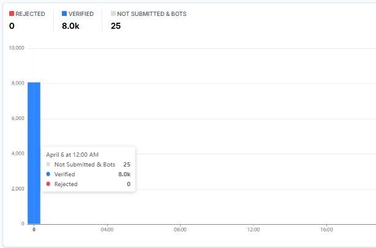

# Friendly Captcha v2 Solver

A Golang solver for [Friendly Captcha](https://friendlycaptcha.com/) v2 challenges.

sorry Benedict & Guido :(



---

## Overview

This project solves Friendly Captcha v2 puzzles by automating the full captcha flow

---

## Usage

```go
package main

import (
	"fmt"
	"log"

	"github.com/xKiian/friendlycaptcha/api"
)

func main() {
	// proxy can be "" to use no proxy
	client, err := api.NewClient("YOUR_SITEKEY", "")
	if err != nil {
		log.Fatal(err)
	}

	token, err := client.Solve()
	if err != nil {
		log.Fatal(err)
	}

	fmt.Println("Token:", token)
}
```

See [cmd/main.go](cmd/main.go) for a full example.

---

## Installation

```bash
go get github.com/xKiian/friendlycaptcha
```

---

## License

This project is licensed under the **MIT License** - see the [LICENSE](LICENSE) file for details.

---

## Disclaimer

This project is **unofficial** and not affiliated with **Friendly Captcha GmbH**. Use it responsibly and in accordance with applicable terms of service.
